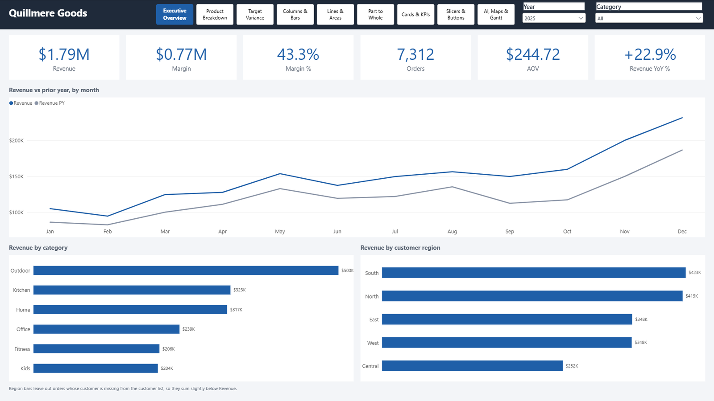

# pbi-pack [](https://github.com/igorpeixoto/pbi-pack/actions/workflows/ci.yml)

Analytics-as-code for Power BI: version-controlled semantic models, CI validation, data tests and semver releases, driven by Claude Code.



The demo report runs on synthetic data for an invented retailer. Its other pages: [Product Breakdown](docs/img/demo-product-breakdown.png), [Target Variance](docs/img/demo-target-variance.png), and a visual gallery: [Columns & Bars](docs/img/demo-columns-bars.png), [Lines & Areas](docs/img/demo-lines-areas.png), [Part to Whole](docs/img/demo-part-to-whole.png), [Slicers & Buttons](docs/img/demo-slicers-buttons.png), Cards & KPIs, and AI, Maps & Gantt.

## What this demonstrates

- **Star-schema modeling in TMDL.** The demo model has two facts at different grains (order line; month × category), four dimensions and a measures table, as plain text you can diff: [`Template-DEMO.SemanticModel/definition/`](pbi-starter/templates/demo/Template-DEMO.SemanticModel/definition/).
- **ETL rules for real-world dirty data.** Hard Rules 5–9 in [`CLAUDE.md`](CLAUDE.md) set the staging order. The demo's Power Query in [`expressions.tmdl`](pbi-starter/templates/demo/Template-DEMO.SemanticModel/definition/expressions.tmdl) applies them to a [documented set of planted defects](demo/README.md#planted-defects): junk tokens, inconsistent status spelling, ship dates before order dates and orphan customers.
- **41 built-in visual types on one model.** Six gallery pages put nearly every built-in visual on the demo star, from ribbon and waterfall charts to the decomposition tree, key influencers, Gantt and a shape map, with bookmarks, buttons and four kinds of slicer. Their JSON is plain PBIR you can read: [`Template-DEMO.Report/definition/`](pbi-starter/templates/demo/Template-DEMO.Report/definition/).
- **Data tests.** [`tests/test_demo_data.py`](tests/test_demo_data.py) regenerates the dataset and compares it byte for byte, and checks each planted defect's exact count, so a test fails if a defect disappears as well as if one grows.
- **CI.** [`.github/workflows/ci.yml`](.github/workflows/ci.yml) runs a forbidden-term check, a secret scan, linting and the data tests on every push and pull request.
- **Release discipline.** [`RELEASING.md`](RELEASING.md), [`CHANGELOG.md`](CHANGELOG.md) and [`skills/power-bi-release/`](skills/power-bi-release/) define the process: a changelog line per change, a semver scheme adapted to BI (what shifts numbers stakeholders already saw is a major bump), and an annotated tag per release.
- **Governance for an AI pair-programmer.** [`CLAUDE.md`](CLAUDE.md) sets a 5-stage flow with user checkpoints and 24 numbered Hard Rules, many with the failure that caused them. The [`skills/`](skills/) carry out each stage.

## Results

In my client work, report delivery went from 60–100 hours to about 3 days with this workflow. That's my experience, not a benchmark.

## Quick start

You need Windows and Power BI Desktop for the report, and Python 3.14 for the tests. The dependency pins in `demo/requirements.txt` were verified on 3.14, and older versions may have no wheel for the pinned numpy.

1. Clone into a short path:

   ```powershell
   git clone https://github.com/igorpeixoto/pbi-pack.git C:\src\pbi-pack
   ```

   The deepest tracked path is about 130 characters, so a clone folder path longer than about 130 characters fails with `Filename too long`. If you need a longer one, add `-c core.longpaths=true` to the clone.

2. Open `pbi-starter\templates\demo\Template-DEMO.pbip` in Power BI Desktop. It opens with its data already loaded, wherever you cloned it.
3. To reload the data from the CSVs, click **Refresh**. That works as is in the clone path above, because `DataFolder` defaults to `C:\src\pbi-pack\demo\data\`. In any other folder, first set `DataFolder` to the absolute path of `demo\data` in your clone (**Home → Transform data → Edit parameters**), because Power Query accepts only absolute paths. Until you do, a refresh stops with a message naming the parameter and keeps the loaded data.
4. Run the tests from the repo root:

   ```powershell
   cd C:\src\pbi-pack
   python -m venv .venv
   .venv\Scripts\python -m pip install -r demo\requirements.txt
   .venv\Scripts\python -m pytest -q
   ```

[`demo/README.md`](demo/README.md) explains the dataset, what the ETL does with each defect, and how to regenerate the data.

## Repository layout

```
pbi-pack/
├── CLAUDE.md                  Governance: 5-stage flow, Hard Rules, release protocol, semver
├── CHANGELOG.md               This repo's changelog
├── RELEASING.md               Release steps for this repo
├── LICENSE                    MIT, for this repo's own work
├── THIRD-PARTY-NOTICES.md     Microsoft's notice for the sample report material
├── ruff.toml, .shellcheckrc   Lint settings used by CI
├── demo/                      Seeded synthetic dataset, its generator and its documentation
├── tests/                     pytest checks on the dataset, the visual catalog and the demo's saved data
├── pbi-starter/               Kit to copy into a new report repo
│   └── templates/demo/        The demo report as a PBIP: TMDL model and PBIR report
├── pbiviz-starter/            Kit for a standalone custom visual repo, with its own governance
├── reference/power-bi-visuals/  Microsoft's Power BI Visuals sample report, to browse in Desktop
├── skills/                    Claude Code skills
│   ├── power-bi-*/            16 skills: step zero, DAX, modeling, Power Query, deployment, release,
│   │                          docs, security, diagnostics, reports, visuals, pages, themes,
│   │                          filters and custom visuals
│   └── power-bi-visuals/references/visual-catalog/  One working visual.json per visual type and feature
├── scripts/
│   ├── check-denylist.sh      Fails when a forbidden term appears in a tracked file
│   ├── build-visual-catalog.py  Rebuilds the sample report copy and the visual catalog
│   ├── stamp-governance.sh, sync-starter.sh  Stamp governance hashes, copy governance to pbi-starter/
│   ├── install-hooks.sh, install-pbi-sync.sh, sync-*.sh  Write to ~/.claude/, see below
│   ├── pbi-sync/              Gated publish from a local repo to a OneDrive deliverable folder
│   └── git-hooks/             Tracked sources of the git hooks
├── user/                      User-level Claude Code instructions, synced into ~/.claude/CLAUDE.md
├── docs/
│   ├── img/                   Demo report screenshots
│   ├── using-the-pack.md      Full reference for the kits, hooks, publishing and setup
│   └── pbi-sync-runbook.html  Operating guide for the OneDrive publish
└── .github/workflows/         ci.yml; sync-claude.yml re-stamps governance on push
```

## License

MIT, see [`LICENSE`](LICENSE). That covers this repo's own work. Microsoft's sample report in `reference/power-bi-visuals/` and the examples copied from it into the visual catalog keep their own notice, see [`THIRD-PARTY-NOTICES.md`](THIRD-PARTY-NOTICES.md).

## Contact

Contact: Igor Peixoto — igor@igorpp.dev

## Using the pack with Claude Code

The quick start above needs none of this section.

### Before you run a script

These scripts change your Claude Code setup outside this repo, for every project on the machine. Read them first.

| Script | What it changes |
| --- | --- |
| `scripts/sync-skills.sh` | Copies `skills/` to `~/.claude/skills/`, and removes `power-bi-*` skills no longer in this repo |
| `scripts/sync-user-claude.sh` | Replaces its marked span in `~/.claude/CLAUDE.md` |
| `scripts/sync-user-settings.sh` | Merges the keys of a `user/settings.json` you add into `~/.claude/settings.json`. The repo ships none, so it does nothing until you add one |
| `scripts/install-pbi-sync.sh` | Installs to `~/.claude/pbi-sync/bin/`, adds session hooks and fills in missing advisor settings |
| `scripts/sync-home.sh` | Runs all of the above, plus `install-hooks.sh` |
| `scripts/install-hooks.sh` | Installs git hooks in this clone. From then on, a commit on any branch that touches `skills/`, `user/` or `scripts/pbi-sync/` runs the matching script above, and so do pulls and checkouts on `main` |

One consequence to decide on first:

- **The session hook updates the pack by itself.** After `install-pbi-sync.sh`, each Claude Code session start can pull this repo, at most once every 6 hours, and the hooks then apply what it pulled. Set `PBI_PACK_AUTOUPDATE=0` to turn that off.

To try the skills and nothing else, run only `sh scripts/sync-skills.sh`.

### Install

Report projects also need the `pbi` CLI, which only reads, queries and validates. Authoring is direct TMDL and PBIR editing.

```bash
pipx install pbi-cli-tool
pbi connect
```

To install everything:

```bash
git clone https://github.com/igorpeixoto/pbi-pack.git C:/dev/pbi-pack
cd /c/dev/pbi-pack
sh scripts/install-hooks.sh
sh scripts/sync-home.sh
```

The session hook looks for the pack in `C:/dev/pbi-pack`. Set `PBI_PACK_HOME` if yours is elsewhere.

### Start a project

For a report repo, copy the kit, open Claude Code in the new folder, and describe the report. The `power-bi-dev` skill then runs the scope stage and enforces the order of the rest.

```bash
cp -r /path/to/pbi-pack/pbi-starter/. /path/to/new-powerbi-project/   # trailing /. so dotfiles come too
```

For a standalone custom visual, copy `pbiviz-starter/` the same way. It has its own governance, because a TypeScript repo needs different rules from a report: `power-bi-visual-dev` takes the place of `power-bi-dev`.

[`docs/using-the-pack.md`](docs/using-the-pack.md) has the full reference: extracting a custom visual into its own repo, the language policy, the release flow, how the git hooks and governance hashes work, publishing to OneDrive, setting up a second machine, and the advisor setup.
