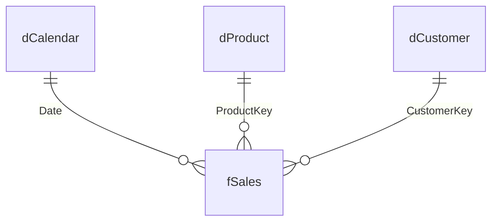

# Power BI Docs Skill

Generates documentation and data dictionaries by querying TMDL metadata via `pbi-cli`.

---

## Documentation Extraction Commands

```bash
# List model metadata
pbi --json model get

# Extract model stats
pbi --json model stats

# Extract tables, measures, and relationships
pbi --json table list
pbi --json measure list --table _Measures
pbi --json relationship list
```

---

## Output Standard

Save generated data dictionaries in `docs/` or `docs/tasks/` in clean Markdown format using the **Project Artifact Language** selected during Stage 1 alignment.

---

## Star-Schema Diagram (built-in `artifact-diagramming`)

A relationship list is not a model diagram. When documenting a model, render the star schema as a mermaid ER diagram — load the built-in **`artifact-diagramming`** skill first for the legibility and theme rules, then derive the diagram from `pbi --json relationship list`:



- One `||--o{` edge per relationship, **one** side (dimension) on the left, **many** side (fact) on the right — mirroring the star schema rule in `power-bi-modeling`.
- Label each edge with the joining column.
- Omit `z_*` design-system tables entirely; they are styling scaffolding, not model content.
- Flag any bidirectional or many-to-many relationship visibly in the diagram — those are the ones a reviewer needs to see.

---

## Publishing a Shareable Data Dictionary (built-in `artifact-design`)

A data dictionary written for stakeholders is a reference document with an audience, not a working file. When the user wants one to **share** (rather than keep in-repo for Claude to read), load the built-in **`artifact-design`** skill and publish it as an Artifact — it renders the mermaid diagram above natively and gives them a private link they choose whether to share.

Keep the in-repo Markdown under `docs/` as well: that copy is what future Claude Code sessions read.
